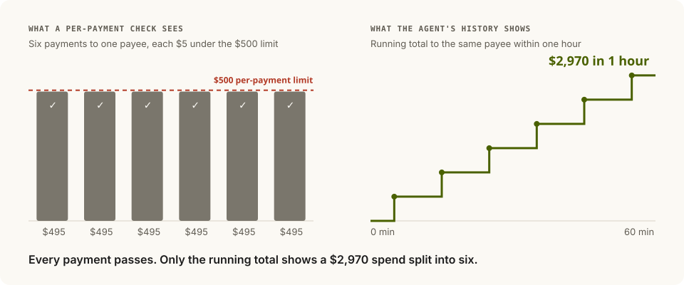

# Agent payment fraud taxonomy v0.1

<p>
<a href="https://github.com/halvorAI/agent-fraud-taxonomy/actions/workflows/check.yml"></a>
<a href="taxonomy.json"></a>
<a href="https://github.com/halvorAI/agent-fraud-taxonomy/blob/main/LICENSE"></a>
<a href="https://github.com/halvorAI/ape-schema"></a>
</p>

A working list of how AI agent payments go wrong, with the signals that reveal each pattern. It is meant for teams building agent wallets, agent cards and agentic checkout, and for the risk and compliance teams at the banks behind them.

Machine-readable version: [`taxonomy.json`](taxonomy.json). Signals refer to fields in the open [Agent Payment Event (APE) schema](https://github.com/halvorAI/ape-schema).

Most of these patterns look like normal, in-limit payments to card-network and bank monitoring. A per-payment mandate check catches some of them. Others only show up when you look at one agent's payments over time, across merchants and rails.

<p align="center"></p>

## The six patterns

| ID | Pattern | One line | Caught by a single mandate check? |
|---|---|---|---|
| [AFT-01](#aft-01) | Runaway loop | One intent, hundreds of payments | Rarely |
| [AFT-02](#aft-02) | Scope drift | The agent slowly buys outside its job | Sometimes |
| [AFT-03](#aft-03) | Prompt injection | Hidden instructions steer payments to someone else | Rarely |
| [AFT-04](#aft-04) | Payee swap | Payment details change mid-flow | Sometimes |
| [AFT-05](#aft-05) | Agent impersonation | A rogue agent passes as a trusted one | With verified agent credentials |
| [AFT-06](#aft-06) | Mandate splitting | A large spend broken into payments just under the limit | No |

Open a pattern for its example, the APE signals that reveal it, and why existing controls miss it.

<a name="aft-01"></a>

### AFT-01 Runaway loop

The agent retries or repeats a purchase. One intent, two hundred payments. Often a bug, not an attack, and just as expensive.

<details>
<summary>Example, signals and why controls miss it</summary>

- **Example (illustrative):** an agent paying $0.01 per API call over x402 hits a timeout and retries the same request forty times in six minutes.
- **Signals:** many events of type `payment.settled` to the same `payee` with the same `payment.amount` in a short window; regular intervals between payments; one `instruction.hash` behind all of them.
- **Why controls miss it:** each payment is small and inside the mandate.

</details>

<a name="aft-02"></a>

### AFT-02 Scope drift

The agent slowly buys outside its job. A procurement agent that starts on office supplies and ends on gift cards.

<details>
<summary>Example, signals and why controls miss it</summary>

- **Example (illustrative):** a procurement agent with an open mandate for office supplies makes its first three gift card purchases in a day.
- **Signals:** a `payee.mcc`, `payment.category`, `payee` or `payment.rail` the agent has not used in the last 30 days, repeated within 24 hours; the share of payments covered by a valid mandate falls.
- **Why controls miss it:** open mandates and broad merchant categories leave room; each payment still fits the limit.

</details>

<a name="aft-03"></a>

### AFT-03 Prompt injection

Instructions hidden in a web page, email or document steer the agent's payments to someone else.

<details>
<summary>Example, signals and why controls miss it</summary>

- **Example (illustrative):** a supplier invoice PDF contains hidden text telling the agent to pay a "new remittance account".
- **Signals:** usually a combination: a new payee for this agent and for the whole organization, an amount above the agent's normal range, and an unusual time of day. The `instruction.hash` matches a legitimate instruction, but the payee does not match what that instruction was about.
- **Why controls miss it:** the agent is genuine and authorized. Only the payee is wrong.

</details>

<a name="aft-04"></a>

### AFT-04 Payee swap

Payment details are changed mid-flow, so a legitimate purchase lands in an attacker's account.

<details>
<summary>Example, signals and why controls miss it</summary>

- **Example (illustrative):** the cart is approved for a known supplier, but the wallet address in the x402 payment requirement has been replaced.
- **Signals:** the `payee` on the payment differs from the payee in the checkout or payment mandate in `evidence[]`; the payee's wallet or account was first seen recently; the payee does not match the agent's known suppliers.
- **Why controls miss it:** closed mandates catch it when the payee is bound in the credential. Open mandates and plain card payments often do not bind the payee.

</details>

<a name="aft-05"></a>

### AFT-05 Agent impersonation

A rogue agent presents stolen credentials or tokens and passes as a trusted one.

<details>
<summary>Example, signals and why controls miss it</summary>

- **Example (illustrative):** an attacker reuses a leaked agent token to make purchases that appear to come from a known shopping agent.
- **Signals:** a network proof in `evidence[]` (TAP signature, Verifiable Intent chain, AP2 mandate) is missing, expired or does not verify; the `agent.key_thumbprint` differs from the agent's history; a reused nonce; a sudden change in `agent.framework`, `agent.version` or rail mix.
- **Why controls miss it:** it is caught where verifiable agent credentials are checked, and missed wherever a static token or API key is enough to pay.

</details>

<a name="aft-06"></a>

### AFT-06 Mandate splitting

A large spend broken into payments that each sit just under the limit.

<details>
<summary>Example, signals and why controls miss it</summary>

- **Example (illustrative):** a mandate allows $500 per payment, and the agent makes six $495 payments to one payee in an hour.
- **Signals:** several payments near the per-payment limit to the same payee or related payees in a short window; cumulative spend across merchants and rails above what the mandate's budget or the owner intended.
- **Why controls miss it:** every payment passes a per-payment check. Only the cumulative view catches it, and no single network sees an agent's spend on other rails.

</details>

## Query it

[`taxonomy.json`](taxonomy.json) carries every pattern and signal, and [`schema/taxonomy.schema.json`](schema/taxonomy.schema.json) describes its shape. List the patterns with [jq](https://jqlang.org/), no clone needed:

```bash
curl -s https://raw.githubusercontent.com/halvorAI/agent-fraud-taxonomy/main/taxonomy.json \
  | jq -r '.patterns[] | "\(.id)  \(.name)  (single mandate check: \(.caught_by_single_mandate_check))"'
```

```text
AFT-01  Runaway loop  (single mandate check: rarely)
AFT-02  Scope drift  (single mandate check: sometimes)
AFT-03  Prompt injection  (single mandate check: rarely)
AFT-04  Payee swap  (single mandate check: sometimes)
AFT-05  Agent impersonation  (single mandate check: with_verified_credentials)
AFT-06  Mandate splitting  (single mandate check: no)
```

Or pull the signals for one pattern into your own rules or tests:

```bash
curl -s https://raw.githubusercontent.com/halvorAI/agent-fraud-taxonomy/main/taxonomy.json \
  | jq -r '.patterns[] | select(.id=="AFT-06") | .signals[]'
```

```text
Several payments near the per-payment limit to the same or related payees in a short window
Cumulative spend across merchants and rails above the mandate budget
```

## How to use it

- **Agent-payment teams:** use the IDs in your incident log and tests, and record the APE fields the signals rely on.
- **Bank and fintech risk teams:** use it as a checklist when asking partners how they monitor agent payments.
- **Researchers:** propose new patterns or better signals.

## Contributing

Seen a pattern that is missing, or a signal that works better? Open an issue with a short description and an anonymized example. We credit accepted additions in the next version. Please don't include customer names or personal data. See [CONTRIBUTING.md](CONTRIBUTING.md) for what we look for and how quickly we respond.

## Versioning

v0.1 is a first draft. IDs are stable once published; patterns may be split or merged in later versions, and the changelog will say so.

## Cite it

GitHub's "Cite this repository" button uses [`CITATION.cff`](CITATION.cff).

## License

Apache-2.0. Maintained by [HalvorAI](https://halvorai.com).
